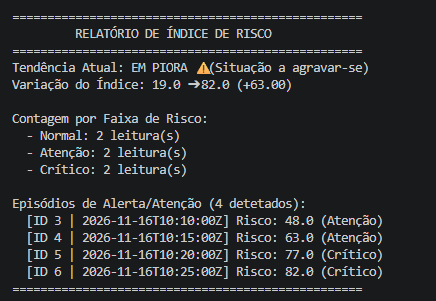

# Global Solution 2026.2 - CitizenTech: Bolsão Alerta RJ

## Integrantes
- Matheus Henrique Pedersen Guerra - RM 571197
- Heitor Anacleto Araújo - RM 573599
- Marcos Vinicius - RM 571080

---

## Como Executar o Projeto

### Pré-requisitos
- Python 3.10 ou superior instalado
- Biblioteca `requests`

### Passo a Passo
1. Aceda à pasta `python/` no terminal e instale a dependência:
```bash
pip install requests

